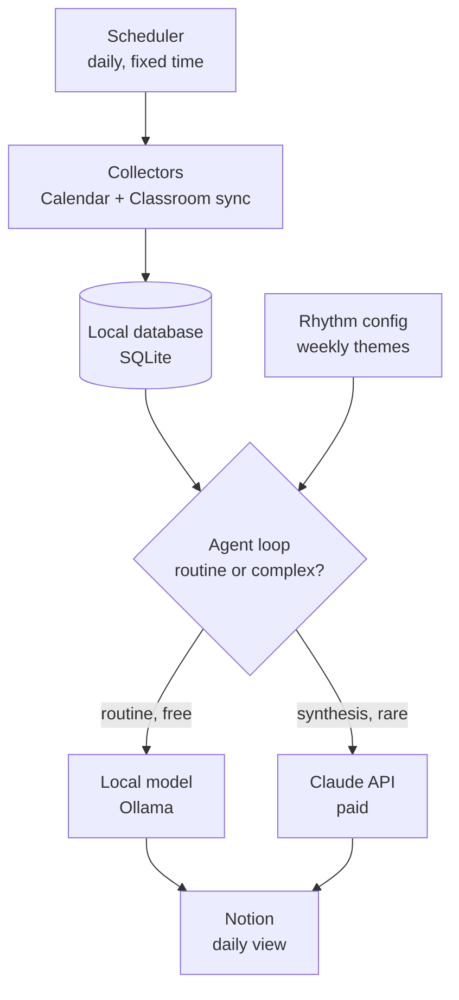

# Architecture — V1

## Pipeline



## Components

### Scheduler
OS-native (Task Scheduler on Windows, `launchd` on macOS, cron on Linux).
Runs `run_daily.py` once per day. No hosted infrastructure. If the laptop was
off at the scheduled time, the run happens the next time it's on — the
pipeline should be safe to run late or to run twice (idempotent writes).

### Collectors
Two independent functions, each wrapping one Google API:
- `sync_calendar()` — pulls events via Calendar API, upserts into SQLite
- `sync_classroom()` — pulls assignments/exams via Classroom API, upserts
  into SQLite

Each collector authenticates independently (separate OAuth scopes), handles
its own failures without crashing the other, and only ever adds/updates rows
— it never decides what's "important," that's the agent loop's job.

### Local database (SQLite)
Single file, single source of truth. Starting schema (extend as needed, don't
redesign):

- `events` — id, source (calendar/classroom), title, type
  (event/assignment/exam), due_at, raw_json, last_synced_at
- `tags` — event_id, tag, source (local_model/claude/manual)
- `rhythm_days` — day_of_week, theme_name, priority_tags (see rhythm config)
- `runs` — run_id, started_at, finished_at, claude_calls_made (for cost
  tracking — should always be 0 or 1 per run in V1)

### Rhythm config
A plain, human-edited file (YAML or JSON, not a database table) — e.g.:

```yaml
monday: {theme: certification_study, priority_tags: [cca-f, exam]}
tuesday: {theme: open_source, priority_tags: [oss, project]}
```

The agent loop reads this before touching the database so "what matters
today" is filtered through the day's theme from the start, not decided ad hoc
by a model each run.

### Agent loop (the router)
The one piece of actual "agent" logic in V1. For each item that needs
processing:

```
if task is routine (tag, dedupe, classify, filter-by-theme):
    call local model (Ollama)
else if task is the daily synthesis ("what matters today, in what order, why"):
    call Claude API — once per run, on already-organized data
```

This is the component most worth testing in isolation before wiring in real
data — feed it fake items and confirm routine tasks never reach the Claude
API call.

### Notion writer
Write-only in V1. Takes the agent loop's output and pushes it into a Notion
page/database via the Notion API. No reads from Notion feed back into the
system in V1 — that's a later-phase feature if I start editing things
in Notion that the agent should notice.

## Orchestration: what kind of agent this is

V1 is a **pipeline with one routing decision**, not a multi-agent system.
`run_daily.py` is the orchestrator and it is **plain code, not a model** -
it calls each stage in a fixed order, isolating failures.

The router in the agent loop is an `if/else` on task type, not a model being
asked which tool to use. Routing therefore costs nothing and cannot
surprise you.

**Why not hub-and-spoke** (a central LLM decomposing work to LLM workers):
it earns its keep when the decomposition cannot be predicted in advance.
Here it can - "sync, filter by today's rhythm, write to Notion" is the same
sequence every day. An orchestrator model would add cost (a call per
decision, breaking the one-paid-call-a-day rule), make failures much harder
to locate, and introduce non-determinism into questions like "what is due
Thursday", which have exactly one right answer.

**Where it would earn its place: Phase 3+.** Opportunity discovery has
genuinely unpredictable decomposition - which sources to search next depends
on what the last search returned. That is the signal that an orchestrator is
warranted. Even then the workers should be local or deterministic wherever
possible, with the expensive model reserved for judgement.

**Three lines not to cross**, in order of cost:

1. The model never decides which API to call. Collectors are dumb by design.
2. The model never loops until satisfied. Unbounded loops are unbounded spend.
3. Paid calls happen once, on already-organised data. Enforced in code:
   `record_claude_call()` refuses a second call in a run, and
   `runs.claude_calls_made` is counted rather than asserted.

| Pattern | Used in V1 | Where |
|---|---|---|
| Pipeline / workflow | yes | every stage |
| Router | yes | agent loop, as `if/else` |
| Parallelisation | no | possible in Phase 3 discovery |
| Hub-and-spoke | no | Phase 3+, if decomposition becomes unpredictable |
| Autonomous loop | no | not planned - no bounded task needs one |

## Trust / cost boundary

Everything above the Notion writer runs locally and costs nothing except the
one daily Claude API call. This boundary is the main thing to protect as the
system grows — see CLAUDE.md's non-negotiable constraints.

## What's explicitly out of scope for V1

- Web search / opportunity discovery
- Gmail or any outbound messaging
- Application tracking, drafting, or autofill
- Any permission-gated "pending approval" queue (nothing needs one yet,
  since nothing outbound exists in V1)
- Multi-skill harness structure (V1 is one loop, not separate named skills)

These are real, and covered in `ROADMAP.md`, but building them before the V1
spine is proven would mean debugging everything at once.