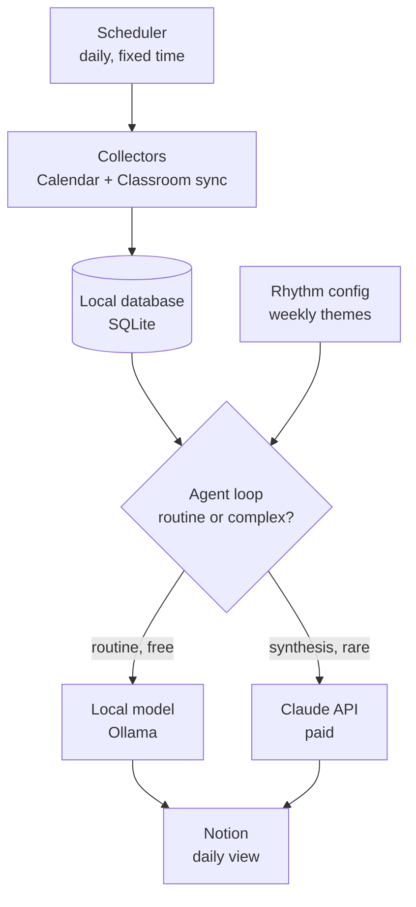

# Architecture — V1

## Pipeline



## Components

### Scheduler
OS-native (Task Scheduler on Windows, `launchd` on macOS, cron on Linux).
Runs `run_daily.py` once per day. No hosted infrastructure. If the laptop was
off at the scheduled time, the run happens the next time it's on — the
pipeline should be safe to run late or to run twice (idempotent writes).

### Collectors
Two independent functions, each wrapping one Google API:
- `sync_calendar()` — pulls events via Calendar API, upserts into SQLite
- `sync_classroom()` — pulls assignments/exams via Classroom API, upserts
  into SQLite

Each collector authenticates independently (separate OAuth scopes), handles
its own failures without crashing the other, and only ever adds/updates rows
— it never decides what's "important," that's the agent loop's job.

### Local database (SQLite)
Single file, single source of truth. Starting schema (extend as needed, don't
redesign):

- `events` — id, source (calendar/classroom), title, type
  (event/assignment/exam), due_at, raw_json, last_synced_at
- `tags` — event_id, tag, source (local_model/claude/manual)
- ~~`rhythm_days`~~ — **not built.** This line conflicted with the Rhythm
  config section below, which says the rhythm is "a plain, human-edited file
  (YAML or JSON, not a database table)". Resolved in favour of the file:
  `rhythm.toml` is the single source of truth, read fresh each run. Nothing
  needs to query a past rhythm, and two copies could disagree.
- `runs` — run_id, started_at, finished_at, claude_calls_made (for cost
  tracking — should always be 0 or 1 per run in V1)

### Rhythm config
A plain, human-edited file (not a database table). Built as **TOML**
(`rhythm.toml` in the repo root) rather than the YAML sketched here: Python
3.11+ parses TOML with the standard library, so it adds no dependency, and
it supports comments so the file can explain itself. The field named
`priority_tags` below is built as `keywords`, which is what it does — items
whose title or course name contains one are pulled into the day's section.

```toml
[days.monday]
theme = "certification_study"
focus = ""                       # your words, shown as-is
keywords = ["cca-f", "exam"]
```

A day with no theme is a supported state, not a placeholder: you still get
everything scheduled and everything due, just with no themed section. This
is what lets the rhythm be filled in gradually.

The agent loop reads this before touching the database so "what matters
today" is filtered through the day's theme from the start, not decided ad hoc
by a model each run.

### Agent loop (the router)
The one piece of actual "agent" logic in V1. For each item that needs
processing:

```
if task is routine (tag, dedupe, classify, filter-by-theme):
    call local model (Ollama)
else if task is the daily synthesis ("what matters today, in what order, why"):
    call Claude API — once per run, on already-organized data
```

This is the component most worth testing in isolation before wiring in real
data — feed it fake items and confirm routine tasks never reach the Claude
API call.

### Notion writer
Write-only in V1, into a **page** (not a database): one page rewritten each
run, so you open one bookmark and today is there. No reads from Notion feed
back into the pipeline — that's a later-phase feature if I start editing
things in Notion the agent should notice.

**How it avoids destroying anything.** The writer records the id of every
block it creates in the `notion_blocks` table, and a later run deletes
exactly those ids. A note, sub-page or database you add to that page is
never touched, because it was never on the list. It refuses outright to
write to a page holding content it has no record of creating, so a mistyped
page id fails loudly instead of quietly emptying a real page.

New blocks are appended *before* the old ones are deleted: if the append
fails the page is still intact, whereas deleting first would risk emptying
it. The marker callout at the top is only a label — an earlier version used
its position as the safety check, which locked the agent out of its own page
as soon as anything was added below it, since appends land at the end.

Items render as bullets rather than to-dos on purpose: a checkbox invites a
click that would do nothing, because V1 never reads Notion back and the tick
would be wiped on the next run.

## Trust / cost boundary

Everything above the Notion writer runs locally and costs nothing except the
one daily Claude API call. This boundary is the main thing to protect as the
system grows — see CLAUDE.md's non-negotiable constraints.

## Known limits and deliberate deviations

Recorded here so they are not rediscovered as surprises.

- **Calendar/Classroom duplicate detection has never fired on real data.**
  It works by decoding the Classroom link Google puts in a mirrored event's
  description, and it is covered by tests, but every real mirror so far has
  belonged to an archived course. Treat it as unproven in the wild until a
  live course produces one.
- **Dedupe arrived in step 1, not step 4.** CLAUDE.md lists dedupe as
  local-model work. What was built is not that: it is an exact ID match
  decoded from a link, with no guessing and no model. The model's dedupe job
  in step 4 (same work described differently in two places) is untouched.
- **Classroom calendars are found by the id prefix `classroom`.** Every
  course calendar in this account follows it, but Google does not document
  it as guaranteed. If it stops matching, list the ids in `CALENDAR_IDS`
  and set `CALENDAR_INCLUDE_CLASSROOM=false`.
- **`rhythm.toml` holds the timezone, not Google.** The file is explicit,
  versioned and works offline. Each sync compares it with the account's
  setting and warns on a mismatch, so drift is detected rather than assumed
  away.
- **An unattended run never opens a browser.** `--no-browser` makes a
  needed sign-in a recorded failure instead of a process that waits
  forever. While the Google Cloud app is in *Testing* status, tokens expire
  about weekly, so this will fire until the app is published.

## What's explicitly out of scope for V1

- Web search / opportunity discovery
- Gmail or any outbound messaging
- Application tracking, drafting, or autofill
- Any permission-gated "pending approval" queue (nothing needs one yet,
  since nothing outbound exists in V1)
- Multi-skill harness structure (V1 is one loop, not separate named skills)

These are real, and covered in `ROADMAP.md`, but building them before the V1
spine is proven would mean debugging everything at once.
